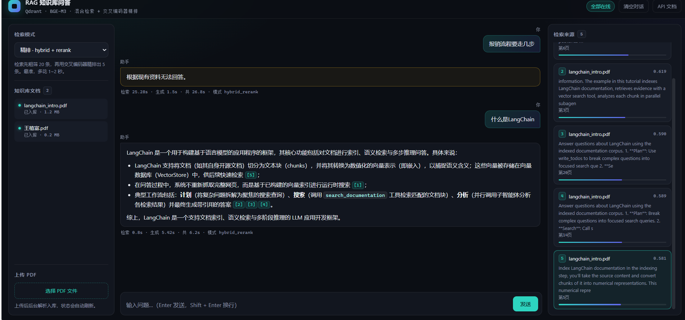

# RAG 知识库问答（rag-knowledge-qa）

基于 **检索增强生成（RAG）** 的企业知识库问答系统：上传 PDF，即可用自然语言提问，
回答**只基于文档内容**并带**可点击的引用溯源**，检索不到就明确拒答，不编造。

技术栈：FastAPI + Qdrant + PostgreSQL + Redis + BGE（embedding/reranker）+ 原生 JS 前端。



> 截图里的三个能力：中间是流式回答与 `[n]` 引用标注；右侧是命中的原文片段与相关度分数；
> 左侧是知识库文档管理与三种检索模式切换（黄色气泡为"知识库中没有该内容"的拒答）。

---

## 功能

- **PDF 问答**：上传 → 后台解析/清洗/切分/向量化入库，状态实时可见
- **混合检索**：BM25（jieba 中文分词）+ 向量双路召回，RRF 融合名次，再用交叉编码器精排
- **流式输出**：SSE 打字机效果，来源先于正文到达
- **引用溯源**：回答中的 `[1][2]` 可点击，联动高亮右侧对应原文
- **拒答机制**：材料不足时按"是否属于本知识库主题"分三种处理——
  主题内但没写 → 拒答（内部资料不能用外部常识替代）；
  问某个组织的内部事务 → 拒答；完全无关的通用问题 → 用模型自身知识回答，
  并在答案开头标注「（以下不属于知识库内容）」、不标任何引用编号
- **闲聊/身份短路**：`你是谁`、`你好`这类问题不走检索（正则分流，0 成本），
  避免弹出 5 个无关来源误导用户，也省掉一次 embedding+rerank
- **三种检索模式**可切换对比：`vector` / `hybrid` / `hybrid_rerank`
- **评估体系**：检索层命中率 + RAGAS 答案层质量，优化前后全程有数字背书

## 架构

```mermaid
flowchart LR
    A[PDF 上传] --> B[解析 pypdf]
    B --> C[清洗: 去页眉页脚噪声行]
    C --> D[切分 300字/重叠30]
    D --> E[BGE 向量化]
    E --> F[(Qdrant)]
    D -. 原文块 .-> G[BM25 内存索引 jieba]

    Q[用户提问] --> R{检索模式}
    R -->|vector| S[向量检索]
    R -->|hybrid / hybrid_rerank| T[向量 + BM25 双路 top20]
    T --> U[RRF 融合 k=60]
    U --> V{rerank?}
    V -->|是| W[交叉编码器精排 top5<br/>bge-reranker-v2-m3]
    V -->|否| X[top5]
    W --> X
    S --> X
    X --> Y{分数低于门槛?}
    Y -->|是| Z[丢弃低分块<br/>材料置空]
    Y -->|否| AA[组装 Prompt: 主题 + 材料 + 问题]
    Z --> AA
    AA --> AB{模型判定}
    AB -->|主题内但材料没写| AC[拒答]
    AB -->|不属于本库的通用问题| AD[通用知识回答<br/>标注"非知识库内容"]
    AB -->|材料够用| AE[带引用回答]
    AD --> AF[SSE: meta → sources → token×N → done]
    AE --> AF
    AC --> AF
```

检索采用工业标准的**两段式架构**：快的海选（向量+BM25 取 top20）→ 准的精排（交叉编码器挑 top5）。

**为什么门槛前面能"丢材料"却不能"直接拒"**：低分块全是噪声，喂给模型只会干扰；
但"分低"有两种完全不同的原因——库里真没有（该拒），或者这根本不是知识库的问题
（该用模型自己的知识答）。在检索层一刀切拒掉，等于把模型的通用能力阉了。

## 评估

评估集：10 题 golden set（7 题有标准答案 + 3 题应拒答），切分参数 300/30。

> 标注复核（2026-10-26）：原「DeepAgents是什么」标为有答案，复核语料后发现全文
> 只有 URL 路径、代码与导航链接，没有一句定义，已改判为**应拒答**。
> 这条标注错误是在把拒答规则收紧到"定义类问题必须有显式定义句"之后跑出来的——
> 尺子变严，反而先纠正了尺子自己。

### 第一层：检索命中率（scripts/eval_retrieval.py，免费秒出）

| 指标 | 纯向量 | 混合(RRF) | 混合+精排 |
|------|:-----:|:---------:|:---------:|
| hit@1 | 43% | 43% | **57%** |
| hit@5 | 57% | 71% | **86%** |
| MRR | 0.476 | 0.548 | **0.679** |
| 拒答正确率 | 0% | 0% | 0% |

精排把 MRR 从 0.55 拉到 0.68：约 1/3 的问题从"正确答案在第 3 名"变成"第 1 条就对"。

**拒答正确率 0% 是这组数字里最有信息量的一列**：3 道应拒答题的 top 分数
（0.545 / 0.605 / 0.661）全部高于 7 道有答案题的最低分（0.438 / 0.508）——
正负例分数区间重叠，**任何单一分数门槛都分不开**。所以拒答最终靠两层：
检索门槛做粗筛（省 token），LLM 按 prompt 判断"材料能否回答"做细判。

### 第二层：答案质量（RAGAS，LLM 当裁判）

| 指标 | 纯向量（6 题） | 混合(RRF)（6 题） | 混合+精排（7 题） |
|------|:-----:|:---------:|:---------:|
| faithfulness（忠实度/反幻觉） | 0.855 | 0.858 | **0.927** |
| answer_relevancy（切题度） | 0.890 | 0.901 | **0.920** |
| context_precision（检索精度） | 0.792 | **0.825** | 0.775 |
| context_recall（检索召回） | **1.000** | 0.722 | 0.810 |

**样本数不同是有原因的**：`怎么创建智能体` 在向量/混合下 top1=0.438 低于门槛被系统拒答
（不计分），而精排分数是另一套标度（0.508 > 0.5），所以被作答了——但它的
context_recall=0（中文"智能体"vs 英文 "agent"，正确页根本没检回来），
单这一题把精排的 recall 拉低了约 0.12。**跨模式比平均数要小心，样本集不一致**。

三个模式各自的胜负点很清楚：

- **faithfulness**：精排最高 0.927。交叉编码器挑出来的块更贴题，模型少发挥
- **context_precision**：混合最高 0.825，精排反而略低——精排偏好代码块，
  把"能回答问题但不是最相关"的块排在了前面
- **context_recall**：纯向量最高 1.000，混合掉到 0.722

recall 的这次反转是**真信号**，不是噪声：逐题看，降分集中在
`如何用LangChain做RAG`（1.0→0.0）、`文本切分器是什么`、`文档切好块之后存到哪`（1.0→0.667）。
原因是**中文提问 × 英文语料**——语料通篇是 LangChain 英文文档，BM25 用中文分词后的
关键词几乎能命中每一块，RRF 融合后把原本正确的块挤出 top5。hit@5 看不出来，
因为它的判定是"沾边就算命中"；RAGAS 的 recall 要求"必要材料真的都在"，一挤就没分。

结论：**混合检索不是普适的赢**。单语场景是纯收益，跨语言场景是"用召回换精度"的赌注。
要根治得换多语言 embedding（BGE-M3），这也解释了为什么 `怎么创建智能体`
在所有模式下都检不回来。

### 性能（RTX 3050 Ti 4GB，本地推理）

| 阶段 | CPU 推理 | GPU 推理 |
|------|:-------:|:-------:|
| 检索（冷启动，一次性） | 28.5s | 25.3s |
| 检索（热态，每次） | 4~12s | **0.49s** |
| 生成（流式） | 3~8s | 3~8s |

## 快速开始

### 0. 前置要求

- Docker Desktop（PostgreSQL / Redis / Qdrant 跑在容器里）
- Python 3.11+（开发环境为 3.13）
- 一个 OpenAI 协议兼容的 LLM API Key（DeepSeek / Qwen / GLM 均可）
- （可选）NVIDIA GPU + CUDA 版 PyTorch，精排提速约 8 倍；CPU 也能跑

### 1. 起依赖服务

```bash
docker compose -f docker/docker-compose.yml up -d
```

### 2. 配置并安装依赖

```bash
cp .env.example .env        # 填入 LLM API Key
pip install -r requirements.txt
```

### 3. 入库文档

```bash
python scripts/ingest.py data/langchain_intro.pdf
```

或者直接在网页里上传 PDF（后台异步入库，状态自动刷新）。

### 4. 启动并访问

```bash
uvicorn app.main:app --reload --port 8000
```

| 入口 | 地址 |
|------|------|
| **网页问答界面** | http://127.0.0.1:8000/ui/ |
| API 文档（Swagger） | http://127.0.0.1:8000/docs |
| 健康检查 | http://127.0.0.1:8000/health |

### 5. 复现评估（可选）

```bash
python scripts/eval_retrieval.py            # 三种检索模式对比
python scripts/eval_ragas.py                # RAGAS 答案质量(会消耗 LLM API)
```

## API

| 方法 | 路径 | 说明 |
|------|------|------|
| POST | `/chat` | 一次性返回完整 JSON（脚本/评估用） |
| POST | `/chat/stream` | SSE 流式返回（前端用），事件序列 `meta → sources → token×N → done` |
| POST | `/documents/upload` | 上传 PDF，后台异步入库 |
| GET | `/documents` | 文档列表与入库状态 |
| GET | `/health` | PG / Redis / Qdrant 三组件健康检查 |

请求体示例：

```json
{ "question": "如何用LangChain做RAG", "top_k": 5, "mode": "hybrid_rerank" }
```

## 技术选型与理由

| 决策 | 选择 | 为什么 |
|------|------|--------|
| 前端 | 原生 HTML/CSS/JS | 只有一个页面、两个状态变量，React 的组件复用与状态管理都用不上；引构建链只会把启动从 2 条命令变 6 条。省下的复杂度换成了能讲清原理的 SSE 解析、防 XSS 渲染 |
| 流式 | SSE 而非 WebSocket | 单向推送场景，一个不关闭的 HTTP 响应就够，不需要 WS 的连接管理；且用 `fetch` 读流（而非 EventSource）才能带 JSON body |
| 检索 | 混合 + 精排两段式 | 实测：纯向量 hit@5 57% → 混合 71% → 精排 86%。BM25 补关键词命中，交叉编码器补语义精排 |
| 切分 | 300 字 / 重叠 30 | 消融实验胜出：hit@1 14%→43%，MRR 0.243→0.476（同样 10 题，500/50 对比 300/30） |
| 评估 | 两层而不是 AutoRAG | 10 题 golden set 撑不起网格搜索（会过拟合测试集），借 AutoRAG 的思想（海选用便宜指标、决赛才上 LLM 裁判）而不引框架 |
| Reranker | bge-reranker-v2-m3 | 必须多语言：中文提问 × 英文语料。bge-reranker-base 实测跨语言打分全贴 0.500（sigmoid 零点 = 无判断力），排序等于随机 |

## 踩坑记录（节选）

完整记录见开发笔记，以下是对后来者最有用的几条：

1. **torch 装成 CPU 版**——`torch.cuda.is_available()` 返回 False 时一切推理都在 CPU 硬算；
   同样的 20 对候选，CPU 4s vs GPU 0.42s。装 CUDA 版只需换后缀：`torch==x.y.z+cu132`。
2. **RRF 融合的身份键**——用"原文前 80 字符"做去重键时，跨页重复的代码块会被当成
   同一条，分数重复累加导致排名虚高。改用 `(filename, chunk_index)` 作为唯一身份。
3. **相关性 ≠ 可回答性**——reranker 只能判断"这段和问题有关"，判断不了"这段能否
   回答问题"。文档通篇讲 LangChain 时，"什么是LangChain"照样拿高分。因此拒答必须
   双保险：分数门槛粗筛 + LLM prompt 细判，实测两层各自独立生效。
4. **切分参数的隐式默认值**——API 上传路径和脚本入库路径用了不同的默认 chunk 参数，
   两条入库路产出不一致。修复方式是把根默认值收口到一处。
5. **静态目录挂载顺序**——`StaticFiles` 挂到 `/` 会成为兜底路由吞掉所有 API，
   必须挂子路径（本项目挂 `/ui`）。

## 已知限制与后续计划

- [ ] chunks 原文入 PostgreSQL（source of truth），Qdrant 只存向量+ID，可随时重建
- [ ] Embedding 换 BGE-M3 对比（bge-small 跨语言弱：中文"智能体"查不到英文 "agent"；
      混合检索在跨语言语料上 context_recall 1.000→0.722，BM25 反而挤掉了正确块）
- [ ] 多文档隔离：无关文档会挤占 top5（实测塞进一份简历后，某题 recall 直接归零），
      需要按知识库/文档做过滤或分集合检索
- [ ] 评估集扩充：10 题只能验证方向，30~100 题才能得到稳定结论
- [ ] 拒答门槛仍靠经验值：正负例分数区间重叠（负例最高 0.661 > 正例最低 0.438），
      分数只做粗筛，真正判定靠 prompt；若要量化拒答质量，需要单独的拒答评估集
- [ ] 通用知识回答没有评估：标注了「以下不属于知识库内容」，但没有指标衡量
      它是否准确；也没接工具，实时信息（天气/股价）只能回答"无法获取"
- [ ] 单轮问答：没有对话历史，用户说"我不明白""再说清楚点"这类追问时，
      系统只能请他重新完整描述（要做多轮得加历史管理 + 检索前的指代消解/查询改写）
- [ ] 拒答边界的判定完全依赖 prompt：规则改一行，`什么是LangChain`（应拒）
      和 `文本切分器是什么`（应答）就可能同时翻转。现在靠"正例/反例对照"把两类分开，
      但这是提示词工程的固有脆弱性——更稳的做法是用一个小分类器或独立的可回答性判断

## 目录结构

```
rag-knowledge-qa/
├── app/
│   ├── main.py               # FastAPI 入口(lifespan/CORS/静态挂载)
│   ├── config.py             # 全局配置(pydantic-settings)
│   ├── api/routes/           # chat(问答+SSE流式) / documents / health
│   └── db/                   # SQLAlchemy 异步 ORM + Alembic 迁移
├── rag/                      # RAG 核心
│   ├── parser.py             # PDF 解析
│   ├── cleaner.py            # 噪声行清洗
│   ├── chunker.py            # 切分(300/30)
│   ├── embedder.py           # 向量化(fastembed/bge-small-zh)
│   ├── retriever.py          # Qdrant 向量检索
│   ├── hybrid.py             # BM25 + RRF 融合
│   ├── reranker.py           # 交叉编码器精排(bge-reranker-v2-m3)
│   └── generator.py          # Prompt 组装 + 同步/流式生成
├── frontend/                 # 原生单页界面(index.html/style.css/app.js)
├── scripts/                  # ingest / eval_retrieval / eval_ragas / ask
├── docker/docker-compose.yml # PG + Redis + Qdrant + Adminer
├── data/                     # 示例文档
├── docs/                     # 架构说明 + 界面截图
└── eval/                     # 评估数据
```

## License

MIT
